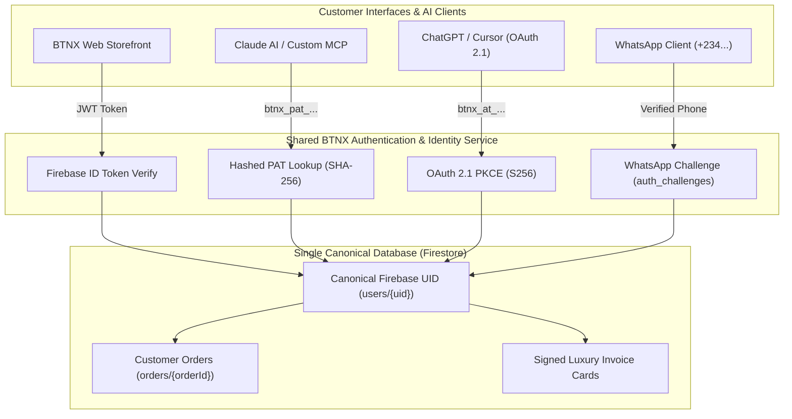

# BTNX Unified Authentication & Identity Architecture

## 1. Architectural Philosophy: One Canonical Customer Identity

Across all BTNX interfaces—the customer web storefront, the administrative dashboard, the remote Model Context Protocol (MCP) server, local MCP connectors, and the WhatsApp Concierge bot—every customer is represented by **one permanent Firebase Authentication UID**:

$$\text{Firebase Authentication UID} \longrightarrow \text{Firestore: } \texttt{users/\{uid\}}$$

External clients, LLM connectors, and messaging channels must never generate disjoint customer profiles or self-assert customer identities.



---

## 2. Server-Side Customer Context (`AuthenticatedCustomer`)

Authentication credentials resolve directly into a strongly typed, server-side context before any business or database operation is permitted:

```typescript
export interface AuthenticatedCustomer {
  uid: string;                    // Canonical Firebase UID
  email: string;                  // Primary verified email
  name?: string;                  // Customer full name
  role: "customer" | "admin" | "support"; // Server-verified role
  authMethod: AuthMethod;         // firebase_id_token | personal_access_token | oauth2_bearer
  authenticatedAt: number;        // Epoch millisecond timestamp
}
```

### Invariants:
1. **No Client-Asserted Identities:** `req.body.userId`, query params, or URL path segments are never trusted as proof of ownership.
2. **Immutable Role Resolution:** Roles are fetched exclusively from server-side Firestore records (`users/{uid}.role`), never from client cookies or JWT custom claims self-asserted by frontend calls.
3. **Fail-Closed Default:** If an authorization token is missing, expired, malformed, or revoked, the backend terminates execution immediately with HTTP 401 Unauthorized or HTTP 403 Forbidden.

---

## 3. Token Taxonomy & Cryptographic Security

| Token Type | Prefix Format | Storage Format | Expiration | Purpose |
|---|---|---|---|---|
| **Personal Access Token (PAT)** | `btnx_pat_[hex]` | SHA-256 Hash in `personal_access_tokens` | 365 Days / Revocable | LLM clients (Claude, Cursor) connecting directly via Bearer header. |
| **OAuth 2.1 Access Token** | `btnx_at_[hex]` | SHA-256 Hash in `oauth_tokens` | 30 Days / Revocable | Third-party OAuth clients (ChatGPT Plugins / GPT Actions). |
| **OAuth Authorization Code** | `btnx_code_[hex]` | SHA-256 Hash in `oauth_codes` | 10 Minutes (Single Use) | Authorization Code Exchange with PKCE S256 verification. |
| **WhatsApp Linking Challenge** | 6-digit numeric | SHA-256 Hash in `auth_challenges` | 10 Minutes (Single Use) | Verifying WhatsApp sender number against canonical UID. |
| **Signed Resource URL Token** | `[sig].[exp]` | HMAC-SHA256 of `type:id:exp` | 24 Hours | Temporary public access to luxury visual invoice/tracking cards. |

---

## 4. Multi-Tenant Authorization Rules

Resource access is governed by the shared authorization gate in `server/src/auth/authorization.ts`:

- **Resource Ownership (`authorizeResourceOwner`):**
  - Allowed if `customer.uid === order.userId`.
  - Allowed if `customer.role === "admin"`.
  - Denied for all other users (HTTP 403 Access Denied).
- **Administrative Operations (`authorizeAdmin`):**
  - Requires `customer.role === "admin"`.
  - Applied to all product upserts/deletions, order cancellations, and shipping policy modifications.
- **Support Staff (`authorizeSupport`):**
  - Requires `customer.role === "admin" || customer.role === "support"`.
