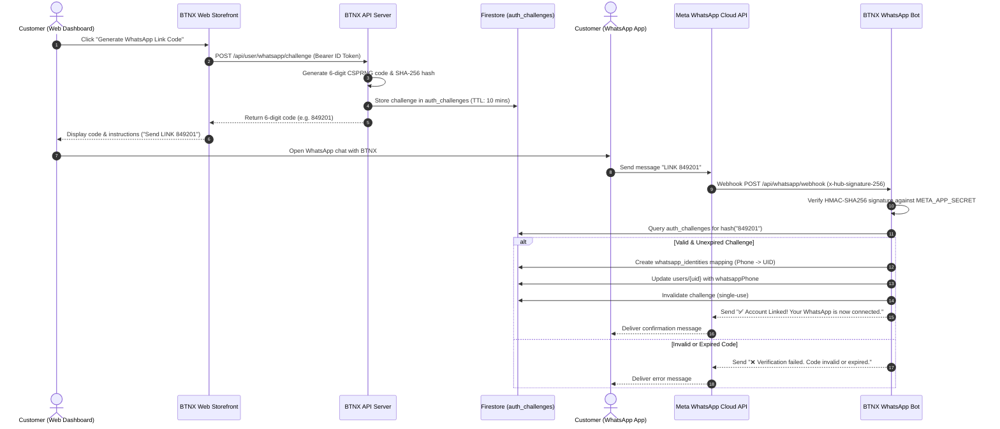

# WhatsApp Account Linking & Bot Security Specification

## 1. Overview

The BTNX WhatsApp Concierge service enables customers to check active orders, track dispatch progress, and download luxury invoices over WhatsApp. 

To eliminate duplicate customer profiles, WhatsApp phone numbers are cryptographically bound to the user's permanent Firebase UID:

$$\text{Verified WhatsApp Phone (E.164)} \longleftrightarrow \text{Canonical Firebase UID } (\texttt{users/\{uid\}})$$

WhatsApp users who have not linked their account can browse the public catalog and sizing advisor, but **cannot view private orders, tracking, or invoices** until they complete verification.

---

## 2. Cryptographic Account Linking Flow



---

## 3. Webhook Cryptographic Security

### Inbound Signature Verification
Meta Cloud API signs incoming webhook requests with HMAC-SHA256 using the application's `META_APP_SECRET`. 

In `server/src/index.ts`, incoming requests are validated timing-safely:
```typescript
const signature = req.headers["x-hub-signature-256"];
const expected = "sha256=" + crypto.createHmac("sha256", process.env.META_APP_SECRET)
  .update(req.rawBody)
  .digest("hex");

if (!crypto.timingSafeEqual(Buffer.from(signature), Buffer.from(expected))) {
  return res.status(403).json({ error: "Invalid webhook HMAC signature" });
}
```

### Handshake Verification
Meta's verification handshake (`GET /api/whatsapp/webhook`) requires a match against `WHATSAPP_VERIFY_TOKEN`. If the environment variable is missing, the endpoint fails closed with HTTP 403.

---

## 4. WhatsApp Bot Command Reference

| Command | Allowed Role | Description |
|---|---|---|
| `LINK <code>` | Guest | Validates a 6-digit web challenge code and links the sender's phone to their BTNX UID. |
| `UNLINK` | Linked Customer | Unlinks the current phone number from the BTNX customer account. |
| `MY ORDERS` / `ORDERS` | Linked Customer | Lists the customer's real orders with signed invoice links. (Guests receive link instructions). |
| `INVOICE <orderId>` | Linked Customer | Generates an HMAC-signed 24-hour visual luxury invoice card URL. |
| `TRACK <orderId>` | Linked Customer | Generates an HMAC-signed parcel tracking card URL with real courier status. |
| `CATALOG` / `PIECES` | All (Public) | Displays current available atelier pieces with prices in Naira. |
| `FIT` / `SIZE` | All (Public) | Launches the interactive AI Master Tailor fit consultant. |
